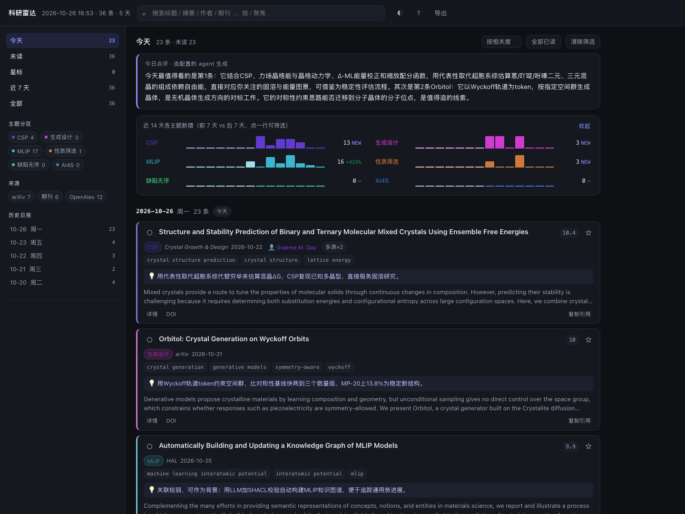

# 科研雷达 Research Radar

一个**每天自动生成**的科研热点日报，为你现在做的方向定制：
**有机分子晶体 / 晶体结构预测（CSP）/ 晶体生成模型 / 机器学习势（MLIP）/ 缺陷与固溶 / 功能导向筛选**。

每天扫一遍 arXiv、期刊 Crossref、OpenAlex、Nature 系新闻源和 GitHub 工具发布，按你的兴趣打分、去重、排优先级，产出两种视图：

- **`dashboard.html`** — 主界面：单文件看板，分区筛选、历史浏览、未读/星标/备注都在这里
- `daily/2026-10-26.md` — 同一天的 Markdown 版（适合归档、贴进组会、喂给别的模型）
- `latest.md` — 永远是最新那份 Markdown

> 部署到 GitHub Pages 的交接状态、token/Secret 步骤写在 **[AGENTS.md](AGENTS.md)**（给接手的 AI）和
> **[HANDOFF.md](HANDOFF.md)**（给你自己）里。

## 看板怎么用

```bash
python3 -m radar serve          # 起本地服务并自动打开（推荐，阅读状态保存最稳）
open dashboard.html             # 或者直接双击文件，离线也能看
```



| 能力 | 说明 |
| --- | --- |
| **分区筛选** | 左侧按主题（CSP / 生成设计 / MLIP / 性质筛选 / 缺陷无序 / AI4S）和来源（arXiv / 期刊 / OpenAlex / 新闻 / 工具）多选，可叠加 |
| **历史浏览** | 左侧「历史日报」按天列出，点进去看那天的完整条目；也可以按主题分组、按期刊排序 |
| **搜索** | 标题/摘要/作者/期刊/命中词全文搜索，命中处高亮；⌘F 之外按 `/` 直接聚焦 |
| **未读 / 星标 / 备注** | 每条可标已读、加星、写一句「为什么留它」，全部存在浏览器本地；未读和星标各是一个视图 |
| **趋势** | 近 14 天各主题新增（按**发表日期**统计，前 7 天 vs 后 7 天），点一行即筛选；没有历史时显示 `–` 而不是假趋势 |
| **统计** | 当前筛选下的主题/期刊/高频命中词分布，点任意一项直接当搜索词用 |
| **导出** | 一键把当前列表导出成 Markdown；单条可复制 BibTeX 引用 |
| **会议** | 未来 120 天的年会/工作坊倒计时 |
| **深色模式** | 跟随系统，也可手动切换 |
| **快捷键** | `j/k` 上下、`o` 打开原文、`s` 星标、`m` 已读、`e` 展开、`/` 搜索、`?` 帮助 |

阅读状态存在 `localStorage`（`serve` 走 http 比 `file://` 更稳，Safari 直接开文件可能禁用本地存储）；换浏览器或清缓存会丢，但看板内容本身每天由 SQLite 重新生成，不依赖它。

## Markdown 日报里有什么

| 板块 | 内容 |
| --- | --- |
| 今日速览 | 最高相关度条目、本周条目最多的主题、升温主题、条目构成 |
| 今日最值得看 | 全站相关度最高的 6 条，带摘要和「命中了哪些关键词」 |
| 按主题展开 | CSP / 生成模型 / MLIP / 性质筛选 / 缺陷固溶 / AI4S 分组，带 7 日趋势箭头 |
| 工具与模型发布 | MACE、fairchem、MatterSim、Orb、DeepMD、pymatgen、RDKit 等新版本 |
| 领域新闻 | Nature 系刊物 + ScienceDaily 的化学/材料报道 |
| 关注课题组的新作 | Graeme Day、David Wales、Ceriotti、Csányi、Marom、Jelfs… 的第一/通讯作者新作 |
| 会议与活动 | 未来 120 天的年会/工作坊（近似日期，以官网为准） |
| 运行健康 | 每个数据源抓了多少、有没有失败，以及漏斗（原始→去重→过滤→入库） |

## 现在就能用

```bash
cd ~/dsh/research-radar

./run_daily.sh                 # 抓一遍：更新看板 + Markdown 日报
open dashboard.html            # 看板；或者 python3 -m radar serve
python3 -m radar status        # 运行历史 + 各主题近 7 天条目数
python3 scripts/verify.py --local   # 自检：配置、数据库、看板是否正常
```

第一次跑大约 1～2 分钟（arXiv 要求每次请求间隔 3 秒）；之后有 HTTP 缓存会快很多。

想让看板立刻有几天历史（默认只从今天开始积累），跑一次补抓：

```bash
python3 -m radar run --hours 168 --backfill   # 一次性：把这一周已发表的按发表日期记进历史
```

## 部署成公开网址（GitHub Pages + 云端每天自动跑）

> **当前状态：代码与脚本已就绪，尚未推送到 GitHub。** 完整执行手册见 `AGENTS.md`；
> 部署前先跑 `python3 scripts/verify.py --local` 自检，部署后用
> `python3 scripts/verify.py --url https://<用户名>.github.io/research-radar/` 验收。

目标：一个固定的公开链接，例如 `https://<你的用户名>.github.io/research-radar/`，
每天 07:30（北京时间）由 GitHub Actions 抓取、提交、并把看板更新到 Pages。

### 一次性部署

1. 建一个 Personal Access Token：GitHub → Settings → Developer settings →
   Personal access tokens → **Fine-grained**，勾 `Administration: read/write`（建仓库）、
   `Contents: read/write`（推送）、`Pages: read/write`（开 Pages）、`Workflows: read/write`（触发 Action）。
   经典 token 勾 `repo` + `workflow` 即可。
2. 把 token 写进一个文件，不要贴进仓库：

   ```bash
   mkdir -p ~/dsh/.secrets
   printf '%s' 'ghp_你的token' > ~/dsh/.secrets/gh_token
   chmod 600 ~/dsh/.secrets/gh_token
   ```

3. 部署：

   ```bash
   cd ~/dsh/research-radar
   export GH_TOKEN=$(cat ~/dsh/.secrets/gh_token)
   python3 scripts/deploy.py --repo research-radar     # 私有仓库加 --private
   ```

   脚本会：建仓库 → 提交并推送 → 开启 Pages（main / 根目录）→ 手动触发一次 Action。
   完成后看板就是 `https://<用户名>.github.io/research-radar/`，`dashboard.html` 也能直接访问。

不想用脚本也行：在网页上建仓库，`git push`，然后 Settings → Pages → Source 选 `main` / `/ (root)`。

### 云端任务

`.github/workflows/daily.yml`：

- `cron: "30 23 * * *"` = 07:30（北京时间）。GitHub 的定时任务可能延迟几分钟到半小时，属正常。
- 每次跑完把 `state/radar.sqlite3`、`dashboard.html`、`index.html`、`daily/*.md` 一起提交，
  下一轮靠这份 SQLite 去重，所以不会重复推送旧论文。
- 想手动跑 / 补一周历史：Actions → daily-radar → Run workflow（`hours=168`、勾 `backfill`）。
- 连续 60 天没有任何提交时 GitHub 会自动停掉定时任务；这里的 bot 每天都会提交，不会触发。

### 配 agent（可选）

看板顶部那段「今日点评」和每条下面的「💡 为什么值得看」来自一个可配置的 LLM：

```bash
cp config/agent.json config/agent.json     # 已经在了，直接改
```

`config/agent.json` 里改 `base_url` / `model`（任何 OpenAI 兼容端点：DeepSeek、OpenAI、Kimi、
本地 Ollama、vLLM 都行）。key 只走环境变量，不落仓库：

```bash
# 本地（key 放仓库外，程序会依次找 env、~/.config/research-radar/agent_key、
# 项目同级的 .secrets/agent_key）
export AGENT_API_KEY=sk-xxx
python3 -m radar agent-test        # 先确认能通
python3 -m radar agent --force     # 只重跑点评，不重新抓取
```

云端：仓库 Settings → Secrets and variables → Actions → New repository secret，
名字 `AGENT_API_KEY`。**不配也能跑**，只是没有点评段落。

一条调用大概 1–2k tokens；结果按天缓存在 SQLite 里，重跑不会重复花钱。

## 装成每天自动跑

```bash
bash install_launchd.sh        # 默认每天 07:40
bash install_launchd.sh 8 15   # 或指定 08:15
```

- macOS 的 `launchd` 在**睡眠期间不执行**，唤醒后补跑一次；如果你经常合盖过夜，把时间设在你通常打开电脑后的十几分钟内更稳。
- 立刻触发一次：`launchctl kickstart -k gui/$(id -u)/com.zhouy.research-radar`
- 看是否跑过：`launchctl print gui/$(id -u)/com.zhouy.research-radar | grep -i 'last exit'`
- 卸载：`bash uninstall_launchd.sh`
- 日志：`logs/run-YYYY-MM-DD.log`、`logs/launchd.out.log`

跑完还会发一条 macOS 通知（`config.json` 里 `notify.macos_notification` 可关）。

## 它凭什么知道我想看什么

依据是你自己在 Codex 里的会话记录（只看本机 `~/.codex/sessions`，不外传）。从 9–10 月的会话里提炼出的主线是：

- 分子晶体 CSP：多晶型、能量图景、basin/MCT、阈值聚类、混合晶体
- 晶体生成模型：Clari、Packora、OXtal、Wyckoff/对称性、流匹配、逆向设计
- MLIP 与通用势：MACE / UMA / MatterSim、主动学习、微调、势函数不确定性
- 功能导向筛选：把「能算的性质」变成「值得算的性质」、共晶 CSP
- 缺陷/无序/固溶体：缺陷形成能、构型熵、SQE 超胞

这套画像写在 `config/config.json` 的 `topics` 里，可以随时改。想让它自己再校准一次：

```bash
python3 -m radar interests --days 60
```

它会统计最近会话里各主题的命中次数，并列出**高频但还没进词表**的术语，方便你决定加不加。

## 调参：让日报更像你想要的

```bash
python3 -m radar explain "Machine learning interatomic potentials for polymorph screening"
# score = 9.66
# topics: csp
#   [csp] 分子晶体结构预测（CSP）与能量图景 :: crystal structure prediction | molecular crystal
```

`config/config.json` 里最值得动的几个旋钮：

| 字段 | 作用 | 建议 |
| --- | --- | --- |
| `topics[].keywords` | 关键词及权重（1.0 泛、2.0–3.0 精准） | 用 `explain` 验证后再加 |
| `topics[].tier` | `core`（CSP/生成/MLIP/AI4S）或 `adjacent`（性质/缺陷） | 相邻主题门槛更高，避免被电池/催化文献淹没 |
| `topics[].require_any` | 必须同时出现其中之一（防止 "flow matching" 把自动驾驶拉进来） | 泛词多的主题一定要加 |
| `run.min_score` / `min_score_adjacent` | 核心/相邻主题的入库门槛 | 日报太少就下调 0.3，太多就上调 |
| `run.max_items_total` / `per_topic` | 总量与每主题条数 | 默认 45 / 7 |
| `sources.*.lookback_days` | 各源回看天数（arXiv 默认 7 天，抗周末断更） | 出差回来想补看就临时 `./run_daily.sh --hours 168` |
| `watch_authors` / `venue_boosts` | 关注的人、优先的期刊 | 直接加名字，格式 `名 姓` |

去重是跨源的：同一篇工作从 arXiv 和期刊各来一次，只算一条，标 `多源×2`。
数据库 `state/radar.sqlite3` 保存见过的所有条目，所以日报里只出现**当天新的**东西。

## 数据源

| 源 | 抓什么 | 备注 |
| --- | --- | --- |
| arXiv API | cond-mat.mtrl-sci / soft、physics.chem-ph / comp-ph、cs.LG 最新投稿 | 免费；要求 3 秒/请求；周末不断更 |
| Crossref | JACS、Chem Sci、Nat Commun、JCTC、JPCL、CGD、Acta Cryst B、IUCrJ、JCP、npj CM、Digital Discovery、CrystEngComm、JPCC、Matter | 免费，按 ISSN 监控新上线 |
| OpenAlex | 8 组主题检索（CSP、多晶型、晶体生成、MLIP、通用势、高通量筛选、缺陷形成能、固溶熵） | 免费额度按 IP 共享（约 $0.10/天，本流程约 12 次请求≈$0.012）；可在配置里填免费 `api_key` |
| Nature RSS / ScienceDaily | 化学与材料新闻 | 用于「事件」线 |
| GitHub Releases | 10 个该领域常用工具 | 有 `GITHUB_TOKEN` 环境变量时限额更高 |

没有配任何 API key 也能完整跑。想更稳可以让 OpenAlex 和 GitHub 认领免费 key：`https://openalex.org/settings/api`、GitHub 的 `GITHUB_TOKEN` 写进 shell 环境即可。

## 目录

```
research-radar/
├── config/config.json       # 兴趣画像、数据源、阈值（唯一需要你改的文件）
├── config/events.json       # 会议日历（近似日期，可自己加）
├── radar/                   # 代码
│   ├── sources/             # arxiv / crossref / openalex / rss / github
│   ├── score.py             # 相关度打分
│   ├── pipeline.py          # 抓取→合并→评分→入库→渲染
│   ├── render.py            # Markdown 日报
│   ├── store.py             # SQLite 去重与历史
│   ├── dashboard.py         # 收集数据 → 渲染单文件看板
│   └── cli.py               # run / dashboard / serve / status / explain / interests
├── radar/web/dashboard.html # 看板模板（CSS/JS 内联，生成时注入数据）
├── dashboard.html           # 生成的单文件看板（每天覆盖）
├── daily/                   # 历史日报 + index.md
├── latest.md                # 最新日报
├── state/radar.sqlite3      # 去重与趋势数据
├── run_daily.sh             # 每日入口
└── install_launchd.sh       # 定时任务安装
```

## 排错

- **某天日报条目很少**：看日报最后一节「运行健康」。科学假期（圣诞、8 月）当天确实没新稿；`arxiv` 显示 0 通常是周末没公告。
- **某个源一直失败**：`python3 -m radar run --dry-run --hours 12` 看具体报错。Crossref 偶尔 503，重跑即可；OpenAlex 超预算会返回 403，等次日或者去申请 key。
- **太杂**：把 `min_score_adjacent` 提到 5.5，或把电池/催化类词加进 `exclude_patterns`。
- **漏了重要的**：先 `explain` 看为什么没命中，再补 `keywords`；不要为了救一条而把泛词权重调到 3.0（会连带放进一堆噪声）。
- **想重看过去某天**：`daily/` 里都在；`daily/index.md` 是索引。删掉 `state/radar.sqlite3` 会重置「已读」状态，下次会把 7 天内的都当新条目——一般别删。

## 还可以加的东西

1. **周报**：把 `daily/*.md` 里的条目按主题聚合，生成「本周进展 + 趋势」，比日报更适合放进组会 PPT。看板里已经有「近 7 天 + 按主题分区」，差一步就能导出。
2. **RSS 输出**：给日报生成 Atom feed，用 Reeder/NetNewsWire 订阅读。
3. **LLM 综述**：本机有 Codex CLI，可以在日报后追加一段「今天这三篇为什么值得看、和你手上的课题什么关系」；注意这会消耗额度，默认没开。
4. **邮件/微信推送**：`run_daily.sh` 末尾挂一个 `curl` 到 Server 酱或 SMTP。
5. **阅读状态回写**：在 `items` 表加一列 `read`，配合一个极简网页点「已读」，日报就会跳过读过的。
